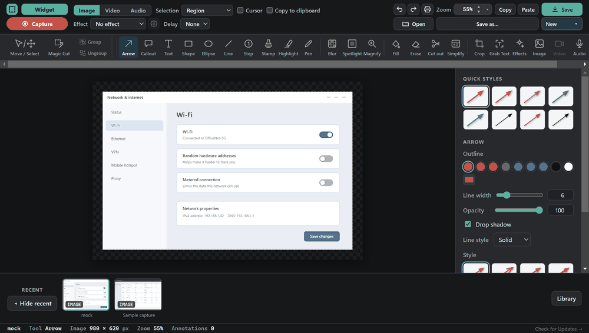
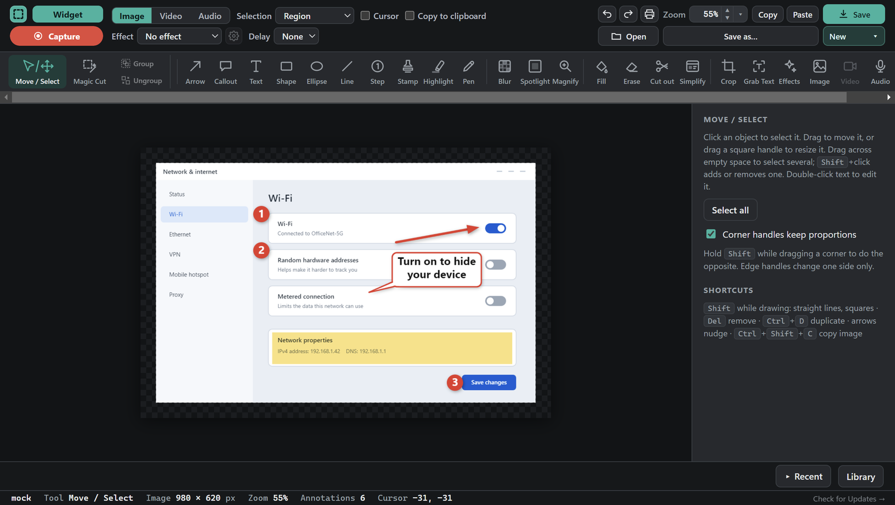
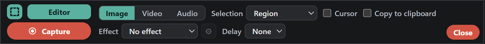
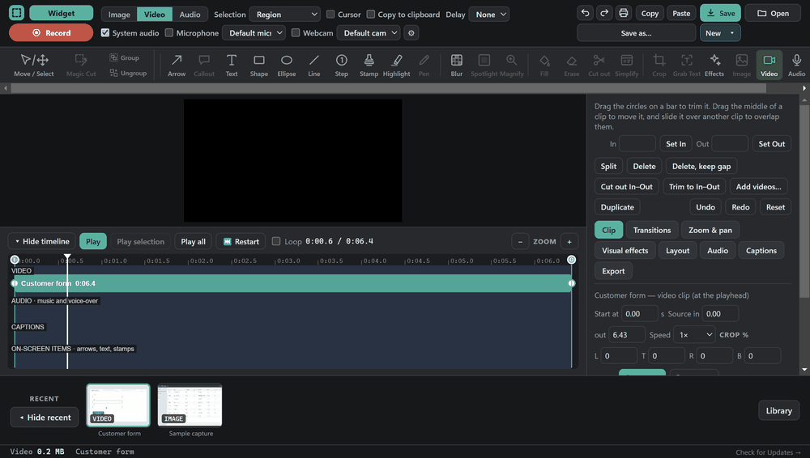
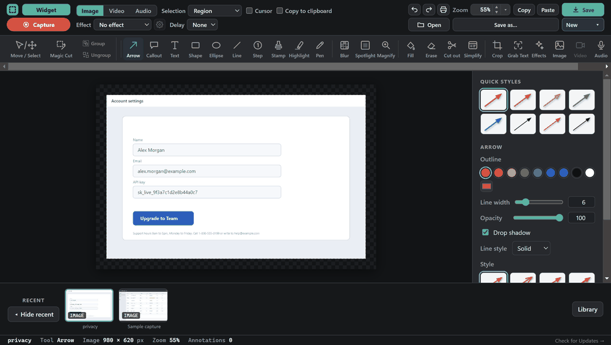
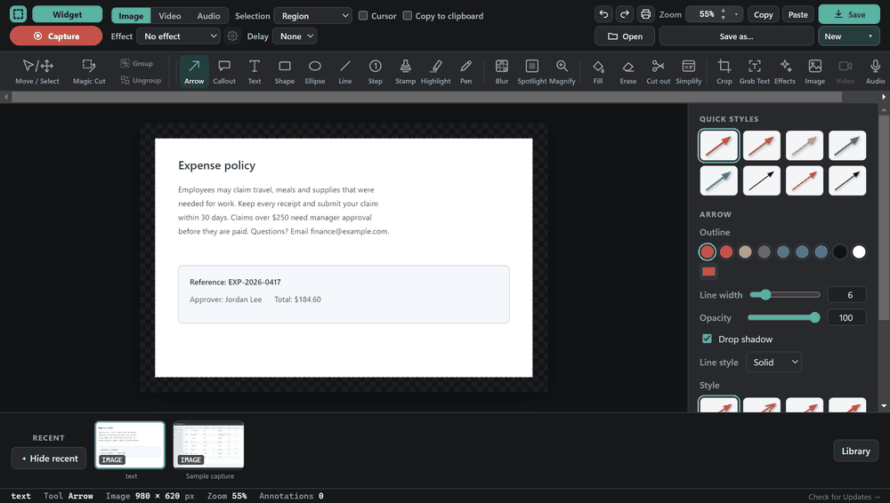

<h1 align="center">Saveit</h1>

<b>Capture it. Mark it up. Record it. Turn it into a how-to guide.</b> 
A free, open-source screen capture, recording and annotation app for Windows.

  

  
  
  
  

## What is Saveit?

Saveit is a screen capture tool in the spirit of Snagit and Camtasia, made for people who explain things to other people: work instructions, how-to guides, bug reports, training material, emails with a quick "click here" picture. You grab part of your screen, mark it up with arrows, callouts and numbered steps, and send it on. Or you record your screen and voice, trim it, and save a video. Or you let Saveit watch your clicks and turn them into an illustrated step-by-step guide.

It is **free, with no account, no subscription and no watermark**, and the whole source code is here under the MIT license, so anyone can use it, read it, change it and share it.

## Screenshots

 The capture bar: pick Image, Video or Audio, choose what to grab, and press Capture. The red Close button puts it away without opening the editor.

## What you can do

- **Capture:** a region, a window, the full screen, a whole scrolling page, step by step (one shot per click), or **Grab Text**, which reads the text off the screen so you can paste it.
- **Mark up:** arrows, callouts, text, shapes, numbered steps, stamps, highlight, blur, spotlight, magnify, crop, Magic Cut, plus fill, erase, cut-out and simplify. Every tool has its own settings panel, and most shapes, text and pictures can be rotated.
- **Copy and paste anywhere:** right-click a picture and choose Copy, then paste the finished picture into Outlook, Gmail, Teams or any other app.
- **Step guides:** click through a task and Saveit builds an illustrated guide, naming each step from what you click ("Click Start") and what you type. Export to Word, searchable PDF, PowerPoint, PNG, JPG or a Saveit file.
- **Record video:** your screen with optional microphone, system sound and webcam. Then edit on a multi-clip timeline: trim and move clips, add transitions, captions and arrows that appear and disappear, a voice-over, equalizer and effects. Save as MP4, WebM or GIF.
- **Record audio:** one or two microphones and the computer's sound, each on its own track, with live level bars. Edit on a multitrack timeline and save as WAV, MP3 or M4A. The audio studio has voice presets, noise reduction, equalizer, compression, de-esser and loudness matching.
- **Stays out of the way:** it lives in the system tray, so the hotkeys work even when the window is closed.

## See it in action

**Edit a recording.** Trim and cut a screen recording on the timeline, then add a caption and a zoom.

**Hide private information.** Blur an email address and a secret key, then spotlight the button that matters.

**Grab Text.** Drag around any text in a picture and Saveit reads it for you to edit and copy.

## Quick start

| Press | What it does |
|---|---|
| **Print Screen** | Capture a region |
| **Shift + Print Screen** | Capture a window |
| **Ctrl + Print Screen** | Capture the full screen |
| **Ctrl + Shift + R** | Start or stop a screen recording |
| **Ctrl + Alt + S** | Start Step Capture (press **F9** to add a step yourself) |

1. **Capture.** Press **Print Screen**, drag over what you want, and the editor opens with your picture.
2. **Mark it up.** Pick a tool (or press its letter: **A** arrow, **C** callout, **N** numbered step, **H** highlight, **T** text) and draw. Click **Move / Select** to adjust anything afterwards.
3. **Share.** Click **Copy** and paste it into an email or chat, or **Save**.

**Making a how-to guide:** press **Ctrl + Alt + S**, do the task while Saveit captures each click, stop, tidy the steps in the editor, and export to Word, PDF or PowerPoint.

**Recording:** switch to **Video** in the capture bar, press **Capture**, then **Ctrl + Shift + R** to stop. Your recording opens in the video editor.

If Print Screen opens Snipping Tool instead, turn off *Settings > Accessibility > Keyboard > "Use the Print screen key to open screen capture"*, then quit and reopen Saveit. Saved images go to your Pictures folder and recordings to Videos.

## Install

**Easiest:** [**Download Saveit for Windows (one click)**](https://github.com/stuartraymor/Saveit/releases/latest/download/Saveit-Setup.exe). Double-click the downloaded file and click **Install**. This link always gives you the newest version.

If Windows says "Windows protected your PC", click **More info** then **Run anyway**. The app is not code-signed yet; see [Code signing](CODE_SIGNING_POLICY.md).

**Or use the zip:** download the latest zip from **Releases**, extract it (right-click, Extract All), and double-click `Install.cmd`.

It installs for your user account only, with no admin rights. Setup downloads the Electron runtime (about 110 MB) once. For offline installs, put `electron-v33.2.1-win32-x64.zip`, renamed to `electron.zip`, next to `Install.cmd`.

`Reinstall.cmd` reinstalls and keeps your library. `Uninstall.cmd` removes Saveit. You can also remove it from *Settings > Apps*. See [SETUP.txt](SETUP.txt) for details.

**Updating:** from version 10.2.0 on, click **Check for Updates →** at the bottom right of the editor. It checks only when you click it, verifies each release's digital signature before installing, keeps your library and settings, and puts the previous version back if the new one does not start. Every release zip is published with a `.sig` signature file and a `.sha256` checksum.

What's new: [10.3.8](docs/changes/CHANGES-10.3.8.md) · [10.3.7](docs/changes/CHANGES-10.3.7.md) · [10.3.6](docs/changes/CHANGES-10.3.6.md) · [10.3.5](docs/changes/CHANGES-10.3.5.md) · [10.3.4](docs/changes/CHANGES-10.3.4.md) · [all versions](docs/changes)

## Where Saveit is going

Saveit aims to be the free, friendly alternative for capturing, explaining and sharing what is on your screen: one small app that does screenshots, video, audio and step-by-step guides well, with no subscription. It is built by one person, so these are ideas rather than promises, roughly in the order I would like to do them:

- A code-signed installer, so Windows stops warning about an unknown publisher (an application to the SignPath Foundation is planned; see [Code signing](CODE_SIGNING_POLICY.md)).
- Cursor highlights, click effects and on-screen key presses in recordings.
- Automatic captions for videos.
- Background noise removal for recordings.
- A light theme.
- More picture formats (TIFF, AVIF, HEIC) and a project file that keeps all your layers.
- Smoother, more consistent wording and polish across the image, video and audio editors.

Ideas, bug reports and feedback are very welcome: please [open an issue](https://github.com/stuartraymor/Saveit/issues).

## Privacy

Saveit has no account, no analytics and no tracking, and it never uploads your captures or recordings. It touches the network only when Setup downloads the Electron runtime from GitHub, and when you click **Check for Updates**. Details: [CODE_SIGNING_POLICY.md](CODE_SIGNING_POLICY.md).

## Run from source

Requires Electron 33: `electron app`.

## License

Saveit is free and open source under the [MIT License](LICENSE). Anyone may use it, copy it, change it and share it. Third-party components are listed in [THIRD-PARTY-NOTICES.md](THIRD-PARTY-NOTICES.md). How releases are signed: [CODE_SIGNING_POLICY.md](CODE_SIGNING_POLICY.md).
